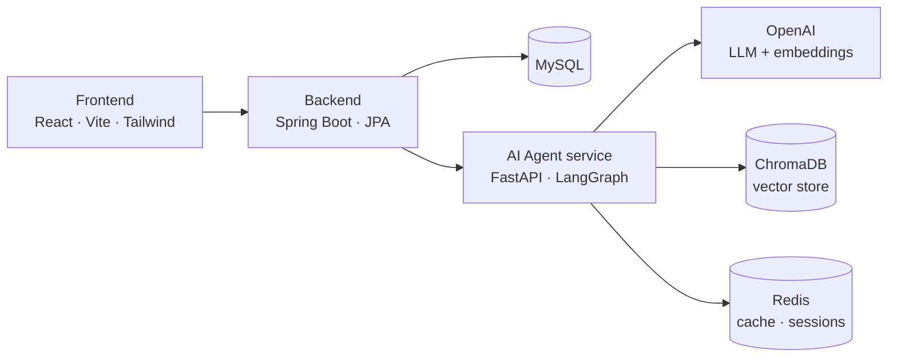

# Kocruit — AI-Powered Recruiting Platform

🏆 **1st place, KOSA AI & Software Engineering Capstone** (Seoul, Jun – Jul 2025) · Team of 4

Kocruit is an end-to-end hiring platform for companies. It covers job-posting creation, applicant screening, interview-panel assignment and interview preparation, and LLM agents handle the judgment-heavy steps.

## ✨ Key Features

- **AI job posting & scoring weights:** a LangGraph pipeline drafts job postings and extracts structured scoring weights (RAG-assisted) that are used to filter applicants.
- **Resume analysis:** AI summaries, color-coded highlights (value fit, skill fit, risk factors, …) and **resume plagiarism detection** through embedding similarity search.
- **Interview question generation:** a LangGraph workflow tailored to the interview type (general, executive, second round, final), drawing on the applicant's resume and portfolio.
- **Interview operations:** interviewer-panel assignment with AI-based interviewer matching, plus schedule reminders and notifications.
- **Applicant analytics:** demographic and trend dashboards with GPT-generated insights.

## 🏗️ Architecture



All services run with Docker Compose. GitHub Actions builds the images and pushes them to GHCR on every push to `main`.

## 👤 My Role — Dowon Kim ([@kimddo1](https://github.com/kimddo1), top committer)

- Built the **LangGraph scoring-weight extraction tool** (with RAG) that turns a job posting into structured criteria for applicant filtering.
- Developed **resume similarity and plagiarism detection** using OpenAI embeddings and ChromaDB, including the re-check flow and UX.
- Added the **final integrated evaluation report** and report caching.
- Implemented the job-posting create/edit flow, interviewer-panel assignment with AI interviewer matching, and interview reminders.

**Stack:** Python · LangGraph · LangChain · OpenAI · ChromaDB · FastAPI · Spring Boot · React · MySQL · Redis · Docker · GitHub Actions

---

# 🛠️ Developer Setup (팀원용 / Korean)


## 🚀 Docker 배포 방법

### 자동 배포 (GitHub Actions CI/CD) ✅
**main 브랜치에 푸시하면 자동으로 GitHub Container Registry에 이미지가 빌드되고 푸시됩니다!**

#### 배포된 이미지
- **Backend**: `ghcr.io/{username}/kocruit-backend:latest`
- **Agent**: `ghcr.io/{username}/kocruit-agent:latest`
- **Frontend**: `ghcr.io/{username}/kocruit-frontend:latest`

#### 자동 배포 조건
- main 브랜치에 푸시
- 다음 파일이 변경된 경우:
  - `backend/**`
  - `agent/**`
  - `frontend/**`
  - `requirements.txt`
  - `package.json`

### 로컬 개발 환경
```bash
# 전체 서비스 빌드 및 실행
docker-compose build
docker-compose up -d

# 또는 한 번에 빌드 및 실행
docker-compose up --build
```

### 프로덕션 환경 (GHCR 이미지 사용)
```bash
# GitHub Container Registry에서 이미지 가져오기
docker pull ghcr.io/{username}/kocruit-backend:latest
docker pull ghcr.io/{username}/kocruit-agent:latest
docker pull ghcr.io/{username}/kocruit-frontend:latest

# 프로덕션용 실행
docker-compose -f docker-compose.prod.yml up -d
```

### 특정 서비스만 빌드
```bash
# Backend만 빌드
docker-compose build backend

# Agent만 빌드
docker-compose build agent

# Frontend만 빌드
docker-compose build frontend
```

### 환경별 설정
- **개발**: `docker-compose.yml` (기본)
- **로컬 DB**: `docker-compose -f docker-compose.local.yml up -d`
- **프로덕션**: `docker-compose -f docker-compose.prod.yml up -d`

### GitHub Secrets 설정
CI/CD가 작동하려면 다음 GitHub Secrets가 필요합니다:
- `GH_USERNAME`: GitHub 사용자명
- `CR_PAT`: GitHub Container Registry Personal Access Token

---

## 🚀 빠른 시작 (팀원용)

### 1. 환경 사전 준비
- Docker & Docker Compose 설치  
  [https://www.docker.com/products/docker-desktop](https://www.docker.com/products/docker-desktop)

### 2. 코드 내려받기
```bash
git clone https://github.com/your-org/kocruit-project.git
cd kocruit-project
```

### 3. Docker 실행
```bash
# 백그라운드에서 실행
docker-compose up -d

# 업데이트 포함하여 실행 (코드 변경 시)
docker-compose up --build

# 컨테이너 종료
docker-compose down

# 컨테이너 완전 정리
docker-compose down -v --remove-orphans
```

### 4. 서비스 접속
- **프론트엔드 (React)**: http://localhost:5173
- **백엔드 API (FastAPI)**: http://localhost:8000  
- **AI Agent API (FastAPI)**: http://localhost:8001
- **Redis**: localhost:6379
- **데이터베이스 (MySQL)**: localhost:3307

---

## 🔄 완전 초기 설정 (처음 받는 사람용)

### 📋 사전 준비사항
- Docker Desktop 설치 및 실행
- Python 3.x 설치 (3.11.9 추천)
- pip 설치
- mysql-connector-python 패키지 설치: `pip install mysql-connector-python`

### 🔄 Docker 완전 초기화 및 실행 순서

#### 1. Docker Desktop 실행
```bash
# Mac에서 Docker Desktop 실행
open -a Docker
# 또는 Spotlight(⌘+Space)에서 "Docker" 검색 후 실행
```

#### 2. 기존 컨테이너/볼륨 완전 정리u
```bash
# 프로젝트 루트 디렉토리에서 실행
docker-compose down -v
```

#### 3. Docker 컨테이너(서비스) 재시작
```bash
docker-compose up -d
```

#### 4. 서비스 상태 확인
```bash
docker ps
```
**예상 결과:**
- `kocruit_fastapi` 컨테이너: Up 상태  
- `kocruit_react` 컨테이너: Up 상태
- `kocruit_agent` 컨테이너: Up 상태
- `kosa-redis` 컨테이너: Up 상태

#### 5. Redis 모니터링 확인
```bash
# Redis 상태 확인
curl http://localhost:8001/monitor/health

# 세션 통계 확인
curl http://localhost:8001/monitor/sessions

# 스케줄러 상태 확인
curl http://localhost:8001/monitor/scheduler/status
```

#### 6. (필요시) DB 완전 초기화
```bash
# AWS RDS를 사용하므로 로컬 DB 초기화는 불필요
# AWS RDS 콘솔에서 직접 관리하거나, 백엔드 API를 통해 데이터 관리
```

#### 7. 테이블 스키마 생성
```bash
# AWS RDS에 직접 연결하여 스키마 생성
mysql -h kocruit-01.c5k2wi2q8g80.us-east-2.rds.amazonaws.com -u admin -p kocruit < initdb/1_create_tables.sql
```

#### 8. 시드 데이터 입력
```bash
cd initdb
python3 2_seed_data.py
```

#### 9. 데이터 확인
```bash
mysql -h kocruit-01.c5k2wi2q8g80.us-east-2.rds.amazonaws.com -u admin -p -e "USE kocruit; SELECT 'users' as table_name, COUNT(*) as count FROM users UNION ALL SELECT 'company', COUNT(*) FROM company UNION ALL SELECT 'jobpost', COUNT(*) FROM jobpost UNION ALL SELECT 'application', COUNT(*) FROM application UNION ALL SELECT 'resume', COUNT(*) FROM resume;"
```

---

## 🛠️ 개별 서비스 실행

### AWS RDS MySQL에 접속하기
```bash
# 직접 MySQL 접속
mysql -h kocruit-01.c5k2wi2q8g80.us-east-2.rds.amazonaws.com -u admin -p

# Enter password: kocruit1234! 입력 후
mysql> USE kocruit;
```

### 백엔드 에러 코드 보기
```bash
docker-compose logs backend
```

### Redis 모니터링 및 관리
```bash
# Redis 상태 확인
curl http://localhost:8001/monitor/health

# 세션 통계
curl http://localhost:8001/monitor/sessions

# 수동 정리
curl -X POST http://localhost:8001/monitor/cleanup

# 수동 백업
curl -X POST http://localhost:8001/monitor/backup

# 스케줄러 시작
curl -X POST http://localhost:8001/monitor/scheduler/start

# 백업 목록 확인
curl http://localhost:8001/monitor/backups
```

### Redis 캐시 관리
AI Agent의 LLM 응답 캐시를 관리할 수 있습니다.

#### 캐시 관리 스크립트 사용
```bash
# 캐시 관리 스크립트 실행
python agent/clear_cache.py
```

**옵션:**
1. **특정 함수 캐시 제거**: 특정 함수의 캐시만 삭제
2. **함수명 변경 캐시 마이그레이션**: 함수명 변경 시 기존 캐시를 새 함수명으로 이동
3. **변경된 함수들의 캐시 제거**: 함수명 변경으로 인한 캐시 충돌 해결
4. **전체 캐시 삭제 (FLUSHALL)**: 모든 Redis 캐시 완전 삭제

#### Docker 명령으로 직접 캐시 삭제
```bash
# 전체 Redis 데이터 삭제
docker exec -it kosa-redis redis-cli FLUSHALL

# Redis 데이터 크기 확인
docker exec -it kosa-redis redis-cli DBSIZE
```

#### 캐시 관련 문제 해결
- **함수명 변경 후 캐시 충돌**: 옵션 3 또는 4 사용
- **개발 중 캐시 혼란**: 옵션 4로 전체 삭제
- **Redis 연결 오류**: Docker 컨테이너 상태 확인 (`docker ps`)

### 프론트엔드 (개별 실행)

처음 복제 했을 때, package.json 또는 package-lock.json이 수정 됐을 때
```bash
cd frontend
npm install
```

실행
```bash
npm run dev
```

→ 브라우저에서 `http://localhost:5173` 접속

#### PWA 설정
```bash
npm install vite-plugin-pwa --save-dev
npm install dayjs
```

### 백엔드 (개별 실행)

backend 디렉토리에 들어온 다음
```bash
# Python 가상환경 생성 및 활성화
python3 -m venv venv
source venv/bin/activate  # macOS/Linux
# venv\Scripts\activate  # Windows

# 의존성 설치
pip install -r requirements.txt

# FastAPI 서버 실행
uvicorn app.main:app --reload --host 0.0.0.0 --port 8000
```

### Agent 폴더 초기 세팅법

#### 1. 가상환경 생성 및 활성화
```bash
cd agent
python3 -m venv .venv

# macOS/Linux
source .venv/bin/activate

# Windows
# .venv\Scripts\activate
```

#### 2. 의존성 설치
```bash
pip install -r requirements.txt
```

#### 3. 환경변수 설정
```bash
# .env 파일 생성 및 설정
OPENAI_API_KEY=sk-...
```

#### 4. 서버 실행
```bash
uvicorn main:app --reload --port 8001
```

---

## 🔐 개발자 전용 테스트 계정

DB가 준비되지 않은 상태에서 테스트를 위해 개발자 전용 계정을 제공합니다.

**계정 정보:**
- 이메일: `dev@test.com`
- 비밀번호: `dev123456`
- 권한: MANAGER (모든 기능 접근 가능)

**사용 방법:**
1. 로그인 페이지에서 위 계정 정보 입력
2. 자동으로 테스트 계정으로 로그인됨
3. 모든 기업 기능 사용 가능

**주의사항:**
- 이 계정은 개발/테스트 목적으로만 사용
- 실제 운영 환경에서는 사용하지 않음
- 일반 사용자는 실제 DB 계정으로 로그인

---

## ⚠️ 주의사항

### 이메일 발송 설정 (Gmail SMTP)
이메일 인증 기능을 사용하려면 Gmail 앱 비밀번호를 설정해야 합니다:

1. **Gmail 2단계 인증 활성화**
   - Gmail → 설정 → 보안 → 2단계 인증 켜기

2. **앱 비밀번호 생성**
   - Gmail → 설정 → 보안 → 앱 비밀번호
   - "앱 선택" → "기타" → 이름 입력 (예: "KOCruit")
   - 생성된 16자리 비밀번호 복사

3. **환경변수 설정**
   프로젝트 루트에 `.env` 파일 생성:
   ```bash
   # Gmail SMTP 설정
   MAIL_USERNAME=your_email@gmail.com
   MAIL_PASSWORD=your_app_password_16_digits
   MAIL_FROM=your_email@gmail.com
   MAIL_PORT=587
   MAIL_SERVER=smtp.gmail.com
   ```

4. **컨테이너 재시작**
   ```bash
   docker-compose restart backend
   ```

### 경고 메시지 해석
시드 데이터 실행 시 다음과 같은 경고가 나타날 수 있습니다:
```
⚠️ 매핑 실패 - email: hong3007@example.com, company: KOSA바이오
⚠️ 사용자 ID를 찾을 수 없음: hong1044@example.com
```

이는 다음 중 하나의 이유입니다:
1. `company_user.json`에 있는 이메일이 `users.json`에 없음
2. `applicant_user_list.json`에 있는 이메일이 `users.json`에 없음

**해결 방법:**
- 경고 메시지는 무시해도 됩니다 (기본 기능에는 영향 없음)
- 완전한 데이터를 원한다면 `users.json`에 누락된 이메일들을 추가하세요

### 데이터 파일 구조 확인
- `users.json`: 사용자 정보 (email 필드 필수)
- `company.json`: 회사 정보
- `jobpost.json`: 채용공고 정보
- `application.json`: 지원서 정보
- `resume.json`: 이력서 정보
- `company_user.json`: 회사 직원 정보
- `applicant_user_list.json`: 지원자 목록

---

## 🛠️ 문제 해결

### Docker 데몬 연결 오류
```bash
# Docker Desktop이 실행되지 않은 경우
open -a Docker
# 잠시 기다린 후 다시 시도
```

### 포트 충돌
```bash
# 포트가 이미 사용 중인 경우
lsof -i :5173  # React 포트 확인
lsof -i :8000  # FastAPI 포트 확인  
lsof -i :3307  # MySQL 포트 확인
```

### 데이터베이스 연결 오류
```bash
# AWS RDS 연결 상태 확인
mysql -h kocruit-01.c5k2wi2q8g80.us-east-2.rds.amazonaws.com -u admin -p -e "SELECT 1;"

# 백엔드가 RDS에 연결할 수 없는 경우
# (ERR_CONNECTION_RESET, Connection refused 등)
docker-compose restart backend
```

### Redis 캐시 관련 오류
```bash
# Redis 연결 오류 (Error 11001 connecting to redis:6379)
# → Docker 컨테이너가 실행 중인지 확인
docker ps | grep kosa-redis

# Redis 컨테이너 재시작
docker-compose restart redis

# 캐시 관리 스크립트 실행 시 연결 오류
# → 로컬에서 실행할 때는 host='localhost'로 설정됨
python agent/clear_cache.py

# Docker 컨테이너 내부에서 실행
docker exec -it kocruit_agent python clear_cache.py
```

---

## 📊 예상 결과

성공적으로 완료되면 다음과 같은 데이터가 생성됩니다:
- **users**: 약 5,000명
- **company**: 13개 회사
- **jobpost**: 65개 채용공고
- **application**: 120개 지원서
- **resume**: 약 3,000개 이력서

---

## 🔧 추가 명령어

### 로그 확인
```bash
# FastAPI 로그
docker logs kocruit_fastapi

# React 로그  
docker logs kocruit_react

# Agent 로그
docker logs kocruit_agent

# Redis 로그
docker logs kosa-redis
```

### 컨테이너 재시작
```bash
# 특정 서비스만 재시작
docker-compose restart kocruit_fastapi
docker-compose restart kocruit_react
docker-compose restart kocruit_agent
docker-compose restart kosa-redis
```

### 전체 서비스 중지
```bash
docker-compose down
```

---

## ✅ 완료 체크리스트

- [ ] Docker Desktop 실행
- [ ] 컨테이너 정상 실행 (`docker ps` 확인)
- [ ] AWS RDS 연결 확인
- [ ] 데이터베이스 스키마 생성
- [ ] 시드 데이터 입력 완료
- [ ] 프론트엔드 접속 가능 (http://localhost:5173)
- [ ] 백엔드 API 접속 가능 (http://localhost:8000)
- [ ] Agent 서버 실행 (http://localhost:8001)
- [ ] Redis 서버 실행 (localhost:6379)

모든 항목이 체크되면 프로젝트가 정상적으로 실행되고 있습니다! 🎉

---

## 📝 initdb 폴더 설명

initdb/ 폴더에 초기 덤프 또는 SQL 파일 넣기

initdb/ 경로는 컨테이너 최초 띄울 때 자동 실행되는 스크립트들이 저장되는 위치예요.

초기 테이블 생성이나 샘플 데이터가 있다면 dump.sql을 넣어두면 자동 반영됩니다.

